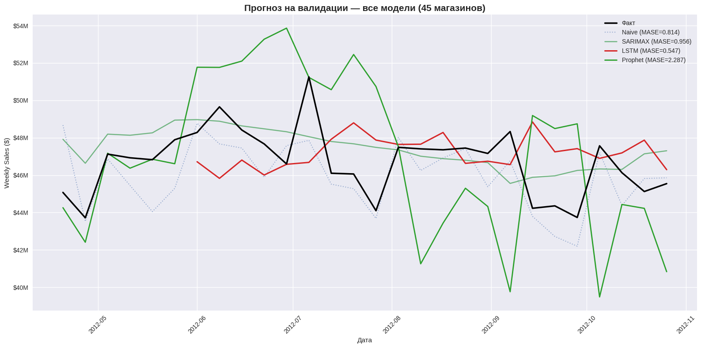
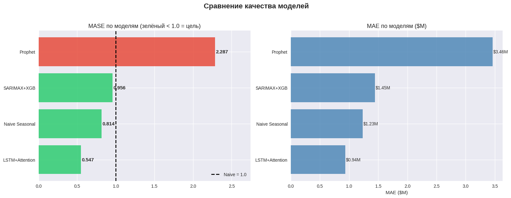
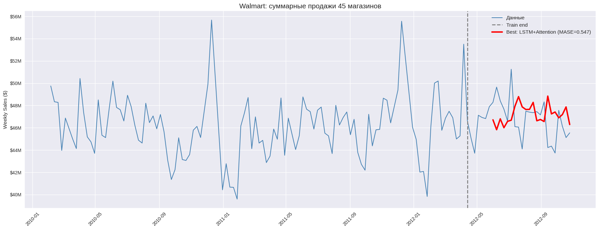

# Прогнозирование еженедельных продаж Walmart (45 магазинов)

Выпускная квалификационная работа (бакалавриат, РУТ (МИИТ), прикладная математика и информатика, 2026).

Задача: одношаговый прогноз суммарных недельных продаж 45 магазинов Walmart с учётом сезонности, праздников и макроэкономических факторов (CPI, безработица, цена топлива, температура).
Сравниваются модели трёх классов: SARIMAX с коррекцией остатков XGBoost, Prophet и LSTM с attention-пулингом, все относительно сезонного наивного прогноза.

Весь код и сохранённые результаты лежат в [`notebooks/walmart_demand_forecasting.ipynb`](notebooks/walmart_demand_forecasting.ipynb).

## Данные

- [Walmart Sales Dataset of 45stores](https://www.kaggle.com/datasets/varsharam/walmart-sales-dataset-of-45stores): 6 435 недельных записей по 45 магазинам, 05.02.2010 – 26.10.2012. Как скачать — в [`data/README.md`](data/README.md).
- Продажи суммируются по всем магазинам: получается один ряд из 143 недель (в среднем $47.1 млн в неделю).
- Хронологический сплит: обучение — 115 недель (до 13.04.2012), валидация — 28 недель (20.04 – 26.10.2012).
- Выбросы целевой переменной винсоризуются по правилу IQR × 3 (исправлено 6 точек).

## Признаки

51 признак, все лаговые и скользящие считаются только по прошлым значениям:

- календарь и сезонность: месяц, неделя года, 6 пар Фурье-гармоник с периодом 52 недели, месячные гармоники, тренд;
- события: флаг праздника, Рождество, День благодарения, Чёрная пятница, Супербоул, День труда;
- макроэкономика и погода: CPI, безработица, цена топлива (и её логарифм и квадрат), температура (и её квадрат);
- история продаж: лаги 1, 2, 3, 4, 8, 13, 26, 52 недели, отношения год к году, скользящие средние за 4, 13, 26, 52 недели, скользящие std, отклонение от годовой средней.

## Модели

| Модель | Как устроена | Подбор параметров |
|---|---|---|
| Сезонный наивный прогноз | значение той же недели год назад | — |
| SARIMAX + XGBoost | SARIMAX(0,1,q) с Фурье-гармониками и экзогенными признаками; XGBoost корректирует остатки | перебор 6 конфигураций |
| Prophet | мультипликативная сезонность, окна праздников Walmart, макро-регрессоры; медианная калибровка прогноза | перебор сетки на отложенных 20% обучающей части; калибровка по валидации |
| LSTM + attention | однонаправленная LSTM, LayerNorm, attention-пулинг по 26-недельному окну (включается гиперпараметром), MLP-голова; цель — log1p продаж с RobustScaler | Optuna (TPE), 30 trials; ранняя остановка |

## Результаты

Метрики из сохранённого запуска ноутбука:

| Модель | Окно оценки | MAE, $ | RMSE, $ | sMAPE | MASE |
|---|---|---:|---:|---:|---:|
| Сезонный наивный | 28 нед. (20.04 – 26.10.2012) | 1 232 608 | 1 559 491 | 2.65% | 0.814 |
| SARIMAX + XGBoost | 28 нед. | 1 446 828 | 1 725 847 | 3.09% | 0.956 |
| Prophet | 28 нед. | 1 343 466 | 1 708 372 | 2.88% | 0.888 |
| LSTM + attention | 22 нед. (20.04 – 14.09.2012) | 937 305 | 1 246 893 | 2.00% | 0.547 |
| LSTM + attention, отложенные данные | 6 нед. (21.09 – 26.10.2012) | — | — | — | 0.613 |

MASE считается относительно сезонного наивного прогноза (период 52 недели) на обучающей части ряда.







## Ограничения оценки

Перед тем как сравнивать модели по таблице, учтите следующее:

1. **Окна оценки разные.** Ноутбук передаёт в LSTM валидацию до последней даты ряда, отдельной тестовой части нет. Поэтому код делит валидацию 80/20: на первых 22 неделях считаются метрики, последние 6 недель отложены. Остальные модели оцениваются на всех 28 неделях. Знаменатель MASE у LSTM считается по более короткой обучающей части (89 недель против 115, из-за окна в 26 недель). Строки таблицы напрямую несравнимы.
2. **Параметры подбирались по той же валидации, на которой считаются метрики.** Для LSTM — Optuna и ранняя остановка, для SARIMAX — выбор конфигурации, для Prophet — калибровочный коэффициент. Поэтому метрики на валидации оптимистичны. На данных, не использованных при подборе, есть только одна цифра: MASE LSTM 0.613 на последних 6 неделях. Базовые модели на этих неделях не считались.
3. **Мало данных.** Один агрегированный ряд из 143 недель, валидация без рождественского сезона, один запуск с фиксированным seed.
4. **Ноутбук не воспроизводится сверху вниз в сохранённом виде.** Ячейки запускались не по порядку. В итоговой таблице ноутбука есть лишняя строка Prophet (MASE 2.287) от более раннего запуска; в таблице выше взят результат ячейки Prophet (0.888). Из этого запуска в выводах не сохранилось, включила ли Optuna attention в лучшей конфигурации.

Чтобы честно сравнить модели, нужно выделить тестовый период, который не используется ни при подборе, ни при ранней остановке, и считать на нём все модели в одном окне с общим знаменателем MASE.

## Запуск

```bash
pip install -r requirements.txt jupyter
# положить CSV в data/ (см. data/README.md)
cd notebooks && jupyter notebook walmart_demand_forecasting.ipynb
```

Обучение LSTM с Optuna (30 trials) занимает около 10–15 минут на CPU.

## Структура

```
notebooks/walmart_demand_forecasting.ipynb   код и сохранённые результаты
figures/                                     графики из сохранённого запуска
data/README.md                               источник данных и инструкция по загрузке
requirements.txt                             зависимости
```
